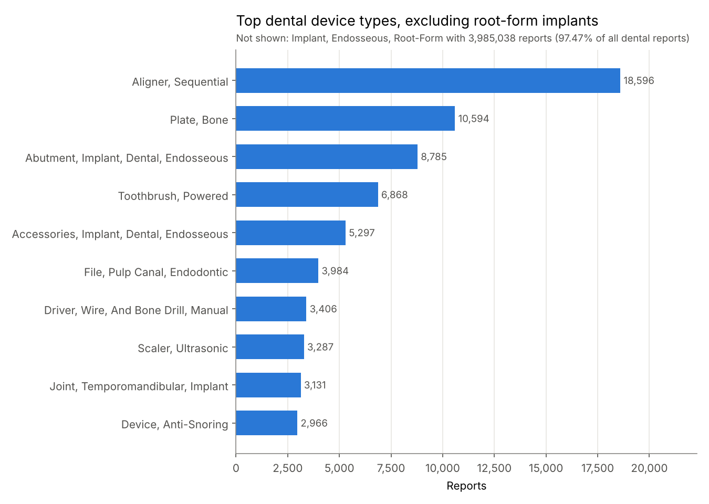
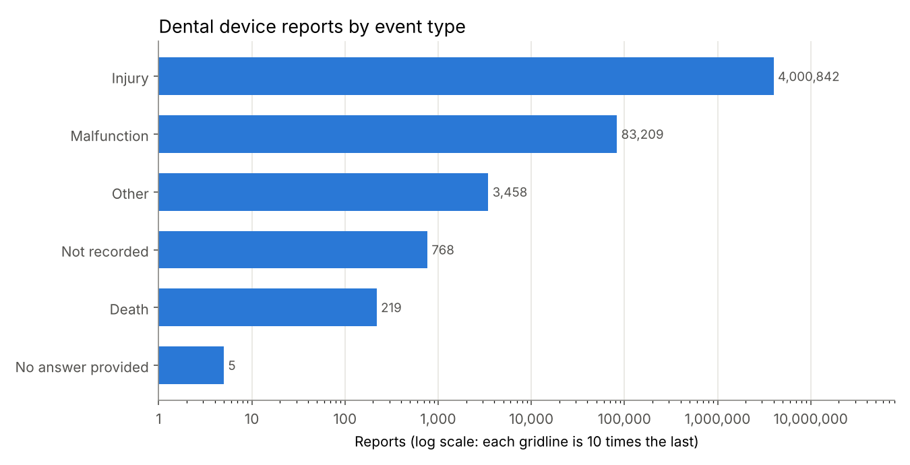
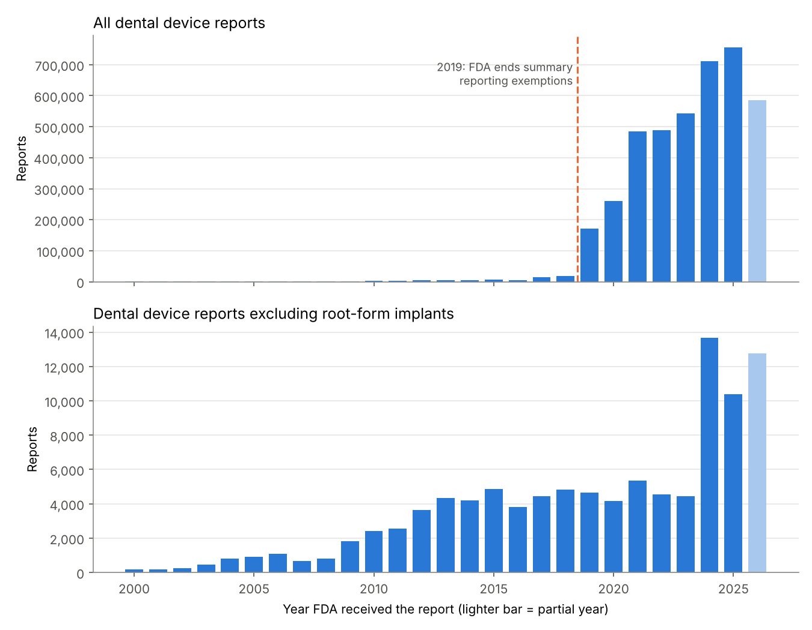
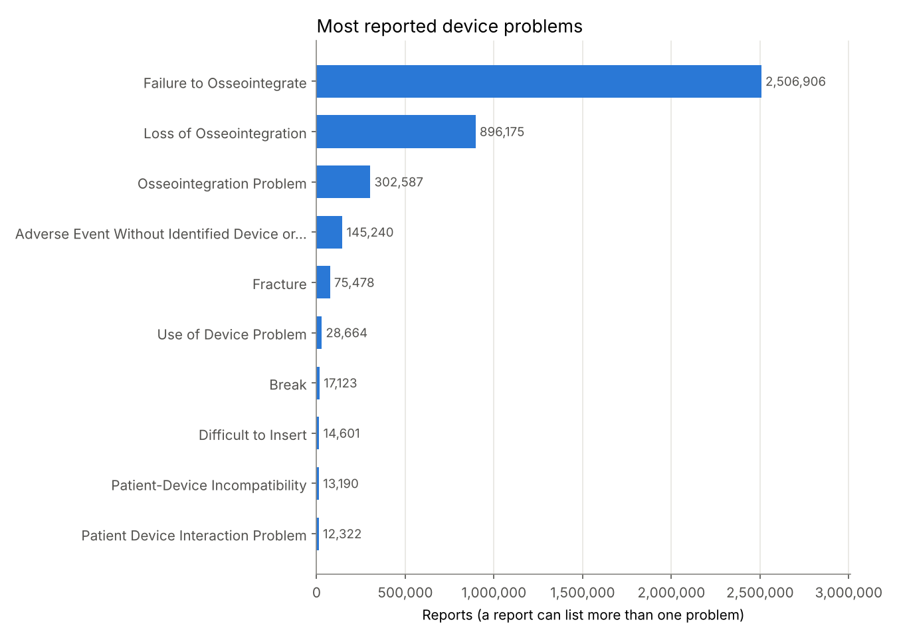

# Dental Device Adverse Events: what FDA's MAUDE reports show about dental devices

## The question

Which dental devices, event types, and problems appear most often in FDA adverse event reports, and how has the number of reports changed over time?

## Why it matters

Dentists place implants, use endodontic files, and hand patients aligners every day. When a device fails in the mouth, the report that reaches FDA is one of the few public signals of a pattern. As a clinician, I want to know what kinds of problems get reported for the devices I use, and I want to know how far those numbers can be trusted before I quote them to a patient or a colleague.

## Read this first: what these counts mean

**Many reports are voluntary, and even mandatory manufacturer reports depend on what manufacturers hear about. Counts show reporting patterns, not failure rates.** There is no denominator: the data does not say how many implants or aligners were used, so a device with more reports is not necessarily less safe. Changes in reporting rules can also move the counts far more than any change in device quality, as finding 3 shows.

## Data source

- **openFDA device adverse event API** (FDA's MAUDE database): https://open.fda.gov/apis/device/event/
- Endpoint: `https://api.fda.gov/device/event.json`
- Data downloaded on October 17, 2026. openFDA reported its last update as October 7, 2026. New reports arrive every week, so a new download gives larger numbers; `results/summary.md` is rewritten from your own run.

### How "dental" is defined (and how it was checked)

Each report carries the device's product code. openFDA links that code to FDA's device classification and adds the review panel as `device.openfda.medical_specialty_description`. This project filters on:

```
device.openfda.medical_specialty_description.exact:"Dental"
```

Checked before use: (1) the field's values were listed with a count query, and "Dental" is one of them; (2) among the reports this filter returns, 4,088,532 of 4,088,560 device rows (99.999%) carry a regulation number in 21 CFR Part 872, the dental devices section of FDA's rules (`results/tables/filter_check.csv`). The few outside Part 872 come from reports that list more than one device. Reports whose product code openFDA could not link to a classification have no specialty and are not counted.

## How to run

You need Python 3.12 or newer (3.13 recommended; on a Mac, the pinned packages need macOS 14 Sonoma or newer) and an internet connection. No API key is needed. If you have one, set it as the `OPENFDA_API_KEY` environment variable and the download script will use it.

Download or clone this repository, open a terminal in the project folder, and run the commands below.

**Mac (Terminal):**

```bash
python3 -m venv .venv
source .venv/bin/activate
pip install -r requirements.txt
python src/01_download_counts.py
python src/02_build_tables.py
python src/03_make_charts.py
pytest
```

**Windows (PowerShell):**

```powershell
py -m venv .venv
.venv\Scripts\Activate.ps1
pip install -r requirements.txt
python src/01_download_counts.py
python src/02_build_tables.py
python src/03_make_charts.py
pytest
```

If PowerShell blocks the activate script, run `Set-ExecutionPolicy -Scope CurrentUser RemoteSigned` once and try again.

| Script | What it does |
|---|---|
| `src/01_download_counts.py` | Sends seven openFDA count queries (retries on errors, treats "no matches" as zero), saves the answers to `data/raw/` |
| `src/02_build_tables.py` | Adds daily counts into years, builds the device, event, and problem tables, runs the filter check, writes `results/summary.md` |
| `src/03_make_charts.py` | Draws four charts into `results/charts/` |

## Method

1. **Counts, not records.** There are over 4 million dental reports, far too many to download one by one. openFDA's `count` option adds them up on FDA's side and returns small tables (for example, one row per event type).
2. **Yearly trend.** Counting by `date_received` returns one row per day; the script adds these into calendar years. 2026 is marked as a partial year.
3. **Implants separated.** Root-form dental implants (product code DZE) make up almost all dental reports, so the trend is also shown for every other dental device, using `AND NOT device.device_report_product_code.exact:"DZE"`.
4. **Percentages** are shares of all dental reports. Device and problem counts can add up to more than the total, because one report can list several devices or problems.

## Top 3 findings

All numbers come from the run on October 17, 2026. Full tables are in [results/summary.md](results/summary.md).

1. **Root-form implants dominate the reports.** Of 4,088,501 dental device reports, 3,985,038 (97.47%) involve root-form endosseous implants. The next device types are far behind: sequential aligners (18,596), bone plates (10,594), and implant abutments (8,785). The three most reported problems are all about osseointegration: failure to osseointegrate (2,506,906 reports), loss of osseointegration (896,175), and osseointegration problem (302,587).
2. **Almost all reports are coded as injuries.** Injury accounts for 4,000,842 reports (97.86%), malfunction for 83,209 (2.04%), and death for 219. FDA counts an event as an injury when it needs medical intervention, such as removing an implant that failed to integrate, which fits this pattern.
3. **The jump in 2019 lines up with a reporting rule change.** Dental reports went from 17,718 in 2018 to 171,678 in 2019 and 756,213 in 2025, almost all of it implants. Reports for all other dental devices stayed between 3,818 and 5,351 a year from 2013 to 2023 before rising to 13,656 in 2024 and 10,378 in 2025. In 2019 FDA ended its Alternative Summary Reporting program, under which some manufacturers, including dental implant makers, had been allowed to send quarterly summaries instead of individual reports ([FDA statement](https://www.fda.gov/news-events/press-announcements/statement-agencys-efforts-increase-transparency-medical-device-reporting)). The timing matches the jump, though this data alone cannot prove the cause.

## Charts









## Limitations

- **No failure rates.** Without the number of devices in use, report counts cannot be turned into risk. Many events are never reported; others are reported more than once.
- **Reporting rules change.** Program changes such as the 2019 end of summary reporting can move counts by tenfold.
- **Unverified reports.** FDA does not confirm that a device caused an event. openFDA itself warns that the data should be treated as unvalidated.
- **Specialty mapping gaps.** Reports whose product code openFDA cannot link to a classification are left out of the dental filter.
- **Report date, not event date.** Years are based on when FDA received the report, which can be long after the event.

## Tests

`pytest` runs 24 tests using small hand-made openFDA answers in `tests/fixtures/`. They cover "no matches" answers, rate-limit retries, bad queries, network failures, the optional API key, adding days into years, labeling blank event types, the filter check, and the clear error messages when an input is missing.

Built in October 2026.

Developed with AI-assisted coding; analysis decisions and interpretation are my own.
